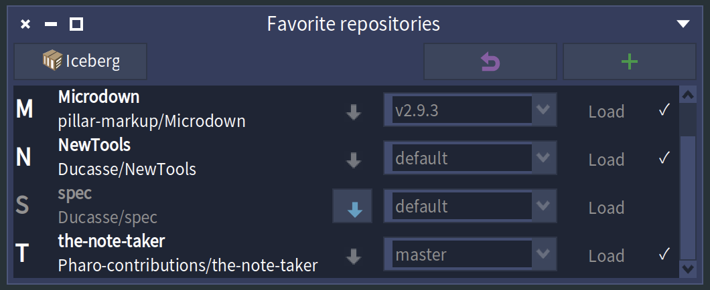

A simple tool fo manage favorite repositories 

To add it automatically to your lovely Pharo images. 

```
StartupPreferencesLoader default executeAtomicItems: {
	StartupAction
		name: 'Load Favrepo'
		code: [
		"The favorite repositories tool: World menu > Versioning > Favorite repositories,
		 or FRApplication new run. Only the Core group, without the tests."
		Metacello new
			baseline: 'Favrepo';
			repository: 'github://Ducasse/Favrepo/src';
			onConflictUseLoaded;
			load: 'Core'
		] runOnce: true}
```

